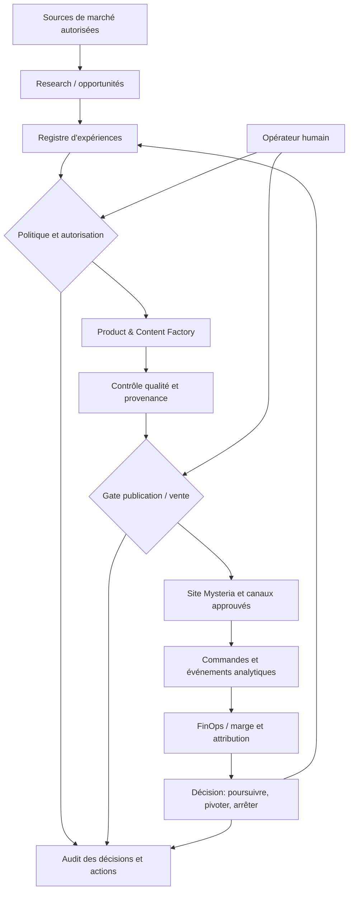

# Architecture cible — moteur d'entreprise réutilisable

**Statut : cible de conception (non implémentée).** Il ne s'agit pas de l'état réel de l'infrastructure.

## Décision structurante

Séparer le **Core Platform**, les **Business Ventures** et **Experimentation & FinOps**. Ne pas dupliquer le moteur pour chaque marque. Voir [ADR-0001](adr/ADR-0001-separate-core-and-ventures.md).

## Chaîne de valeur

## Responsabilités techniques

| Composant | Core ou venture ? | Livrable MVP |
|---|---|---|
| Opportunity intelligence | Core | Fiche d'hypothèse avec sources, score explicable, incertitudes |
| Experiment registry | Core | Hypothèses, seuils, budgets, résultats, décision signée |
| Agent/workflow runtime | Core | Workflows durables, idempotence, retry, compensation, trace |
| Policy / approvals | Core | Autorisations vérifiables, rôles, plafonds et kill-switch |
| Product/content factory | Core + configurations métier | Un guide numérique et des éléments promotionnels originaux |
| Commerce & payment adapter | Core | Catalogue, checkout délégué, commandes, remboursements, export financier |
| Publication connectors | Core | Adaptateurs désactivés par défaut, API officielles et consentement |
| Mysteria venture | Venture | Identité éditoriale, produit pilote, offre, page, localisation |
| Analytics & FinOps | Transverse | Tableau de marge et tests mesurés par canal |

## Stack MVP raisonnable

- **Frontend** : site responsive Next.js (pas d'application native initialement).
- **API et orchestration** : FastAPI / Python ; workers asynchrones et états persistés, pas nécessairement un framework multi-agents complexe au départ.
- **Données** : PostgreSQL ; stockages objets pour contenus ; Redis uniquement si nécessaire ; `pgvector` si un besoin RAG mesuré apparaît.
- **IA** : API de modèles hébergés, routage selon qualité/coût, sorties structurées, validations explicites, cache et journal de coût.
- **Paiement** : checkout tiers hébergé ; aucune donnée de carte directement stockée.
- **Exploitation** : développement local Docker Compose, CI GitHub Actions, puis déploiement cloud minimal et infrastructure Terraform.
- **Scalabilité différée** : Kubernetes/OpenShift, multi-cluster, GPU privés, opérateurs, applications mobiles et pipelines vidéo avancés uniquement après justification économique.

## Frontières et événements

Décrire dès le départ `venture_id`, `experiment_id`, `product_id`, `publication_id`, `order_id`, `decision_id` et `cost_event_id`. Toute action exécutable comporte une autorisation, un identifiant idempotent, un coût maximum et un résultat auditable.

Le modèle ne doit **jamais pouvoir appeler directement** une API de paiement, de publicité, de suppression ou de publication sans passage par la politique de contrôle. Les connecteurs ne reçoivent que des jetons de portée minimale, côté serveur.

## Chaîne de confiance et exploitation

1. Secrets hors du dépôt, rotation des accès, séparation test / production, moindre privilège.
2. Sauvegardes PostgreSQL / objets, exercice de restauration avant mise en vente.
3. Protection contre prompt injection des sources externes ; contenus tiers traités comme données non fiables.
4. Revue des droits sur textes, images, vidéos, voix et marques ; déclaration des contenus synthétiques quand nécessaire.
5. Consentement, confidentialité, gestion de suppression/export utilisateur, politique de conservation.
6. Contrôle des publications sensibles et des récits spéculatifs ; qualité par échantillonnage humain.
7. Suivi économique de chaque job (tokens, vidéo, stockage, transaction, acquisition) et plafond par environnement.
8. SLO, alertes de coûts, piste d'audit, système de suspension immédiate des agents et des publications.

## Contrats d'intégration

- **Réseaux sociaux** : uniquement les API officielles autorisées et les comptes liés. Ni scraping interdit ni contournement de limitations.
- **Amazon/KDP** : workflow éditorial préparatoire ; la possibilité de création de fiches/publication dépend de l'accès autorisé et des règles effectives de chaque produit Amazon. Aucun automatisme de publication présumé.
- **Produits IA/personnalisés** : présenter comme divertissement ou analyse symbolique lorsque tel est le cas ; éviter les conseils médicaux, financiers, juridiques ou prédictions présentées comme certaines.

## Critère de bonne architecture

La nouvelle activité `venture_2` peut utiliser la même chaîne d'hypothèse, paiement, publication et mesure **sans modifier les règles métier de Mysteria**, uniquement par configuration et modules métier séparés.
